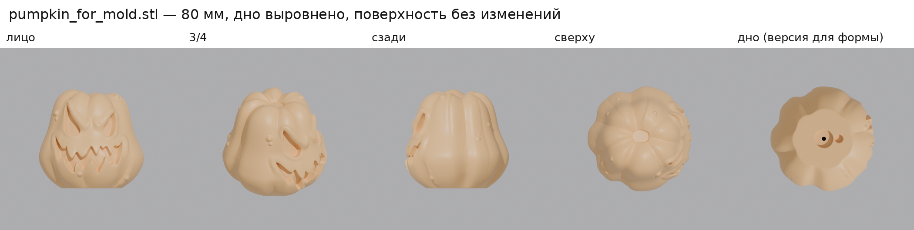
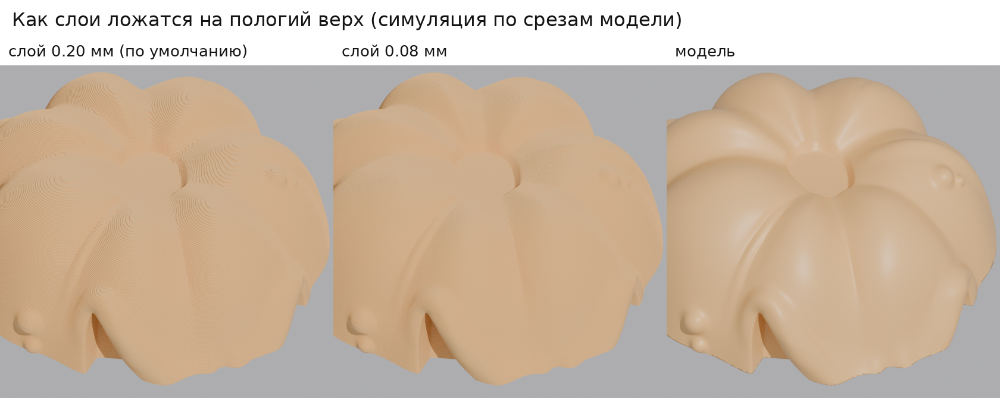
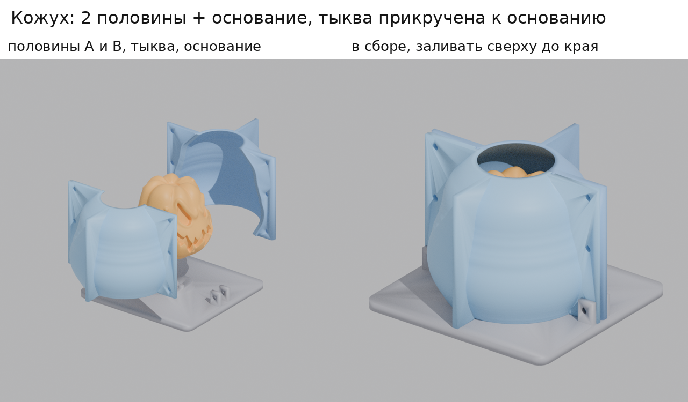
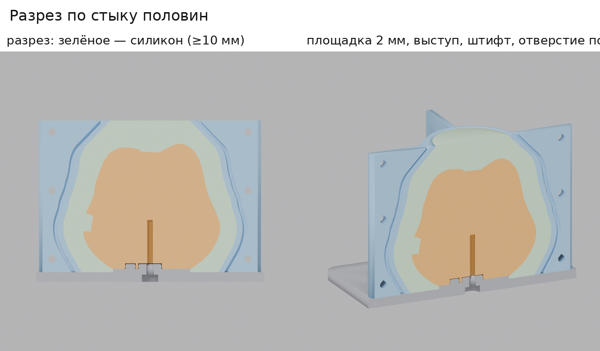
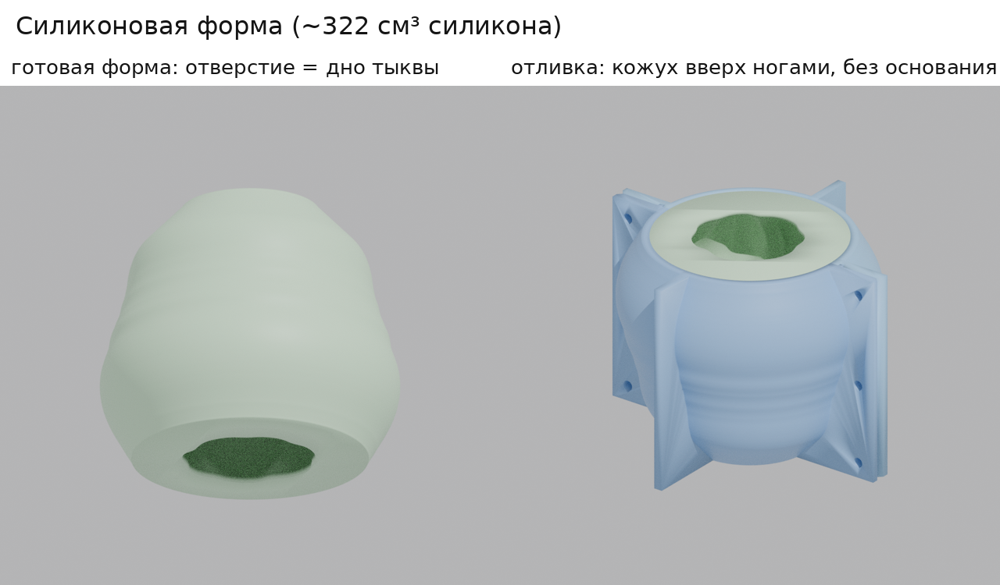

# Тыква для силиконовой формы: файлы для печати и кожух

Всё сделано из `forForm.zip` (модель `forForm.blend`). OBJ в корне репозитория не использовался.

## Файлы

| Файл | Что это |
|---|---|
| `print/pumpkin_for_mold.stl` | **Тыква-мастер для формы.** Высота 80 мм, в дне гнёзда под крепление к основанию кожуха |
| `print/pumpkin_no_holes.stl` | Та же тыква без отверстий в дне (если нужна просто фигурка) |
| `print/mold_shell_A.stl` | Половина кожуха A (с выступом-гребнем на стыке) |
| `print/mold_shell_B.stl` | Половина кожуха B (с пазом на стыке) |
| `print/mold_base.stl` | Основание кожуха: площадка под тыкву, центрирующий выступ и штифт, ушки для нижних болтов |
| `tools/build_mold.py` | Скрипт, которым всё это сгенерировано из `forForm.zip` (в нём можно поменять толщину силикона, высоту и т. п.) |

## 1. Тыква



Что изменено:

- **Размер:** высота 80 мм, в плане 84.7 × 84 мм.
- **Дно выровнено.** Плоское дно в исходной модели было наклонено на 0.44°, поэтому тыква касалась стола только краем. Я повернул модель целиком, как жёсткое тело: форма не меняется, а дно теперь лежит на столе всей площадью (~17 см²).
- **Сетка облегчена** с 1.94 млн до 0.7 млн треугольников. Максимальное отклонение от исходной поверхности 0.005 мм, это в 16 раз тоньше самого тонкого слоя печати. Файл весит 35 МБ вместо 97.
- **Только в `pumpkin_for_mold.stl`:** в дне есть гнездо Ø14.5 мм под центрирующий выступ, гнездо Ø6.5 мм под штифт (чтобы тыква не провернулась) и отверстие Ø3.4 мм под болт M4, который вкручивается снизу через основание. Дно в форму не копируется: на его месте будет отверстие готовой формы. Поэтому на отливках этих отверстий не будет.

Как проверял: итоговые STL сравнил с исходной моделью из `forForm.blend`. Выше дна отличие не больше 0.005 мм. Рендеры с 7 сторон практически совпадают с исходником попиксельно (отличается только дно версии для формы). Меш замкнутый, без дыр и вывернутых нормалей.
В исходной модели есть крошечное самопересечение поверхности (1–2 мм) в самом уголке рта. Оно было в оригинале, я его не трогал. Слайсер с таким справляется, на печать оно не влияет.

### Откуда «завитушки» сверху

Верх тыквы — это несколько очень пологих куполов (вершины долек) и плоский срез хвостика. Принтер печатает горизонтальными слоями, и на пологом месте каждый слой выходит наружу широкой ступенькой. Слайсер показывает эти ступеньки как кольца-«горизонтали», а маленькие островки между дольками заливает линиями «верхней поверхности». Это и есть завитушки. Из STL это не убрать: всё решает высота слоя.



Я нарезал модель в слайсере. При слое 0.08 мм и 4 стенках всю наружную поверхность печатает внешняя стенка, и островков верхней заливки не остаётся (0 г против отдельных пятен при 0.20 мм). Ступеньки остаются, но в 2.5 раза мельче.

### Настройки Bambu Studio для тыквы

1. Импортируйте `pumpkin_for_mold.stl`. **Не нажимайте «Auto orient»**: модель уже стоит правильно, дном на столе и лицом к переду стола.
2. Профиль процесса: **0.08mm Extra Fine** (или **0.08mm High Quality**: дольше, но поверхность ещё чище).
3. Вкладка *Strength*:
   - **Wall loops: 4.** Оболочка ~1.7 мм, тыква не промнётся, когда её будут вынимать из силикона.
   - **Top shell layers: 10.**
   - **Bottom shell layers: 5.**
   - **Sparse infill density: 10 %.**
   - **Sparse infill pattern: Lightning.** «Молния» строит заполнение только там, где оно нужно, чтобы держать верх. Внутри практически пусто: внутренности не важны, важна поверхность.
4. *Support*: **выключено.** Я проверил: при слое 0.08 мм ни один слой не нависает над предыдущим больше чем на ~1 мм, лицо печатается без поддержек. Если поддержки включить, слайсер полезет в отверстия в дне.
5. *Quality → Seam position*: **Back**. Шов уйдёт на затылок тыквы.

Расход по оценке слайсера: **~49 г PLA вместо ~77 г** при настройках по умолчанию (слой 0.20, заполнение 15 % «сетка»). Одно заполнение уменьшается с ~51 г до ~3 г. Печать из-за тонкого слоя будет дольше, точное время покажет Bambu Studio.

Совет для мастер-модели: силикон копирует всё, вплоть до следов слоёв. Если отливки нужны гладкими, нанесите 1–2 слоя грунта-наполнителя из баллончика и слегка отшлифуйте (P600–P800). Другой вариант — покрыть эпоксидным покрытием для 3D-печати. Перед заливкой краска и лак должны полностью высохнуть: свежее покрытие может помешать отверждению платинового силикона.

## 2. Кожух для заливки силикона





### Как устроено и почему так

- **Тыква стоит дном вниз на основании и прикручена к нему снизу болтом M4.** Напечатанная тыква почти пустая (~50 г при объёме 278 см³), поэтому в жидком силиконе её выталкивало бы вверх с силой около 2.5 Н (~250 г), и она всплыла бы или перекосилась. Прикрученная болтом, она стоит намертво. Выступ и штифт ставят её точно по оси кожуха, поэтому силикон получается одинаковой толщины со всех сторон.
- **Силикон заливается сверху**, через отверстие Ø49 мм в верху кожуха (вы так и предлагали). Воздух свободно уходит вверх, уровень видно. Заливать до края, тогда над макушкой будет 11 мм.
- **Толщина силикона не меньше 10 мм везде:** минимум 10.0 мм, обычно 10.5–13 мм, в глазах, во рту и между дольками больше. Внутренняя стенка кожуха повторяет силуэт тыквы. Силикона нужно **~322 см³, это ~350–390 г** в зависимости от плотности (1.08–1.2 г/см³); берите с запасом 400–450 г. Для сравнения: прямоугольный короб, как на эскизе, съел бы ~800 г.
- **Две половины + основание**, как «1 часть» и «2 часть» на эскизе. Половины разделены вертикальной плоскостью. Внутренняя поверхность — тело вращения, поэтому каждая половина снимается вбок и ни за что не цепляется.
- **Дно тыквы становится отверстием готовой формы.** Под тыквой на основании есть площадка высотой 2 мм. Благодаря ей край отверстия в силиконе — полноценная стенка 2 мм, а не тонкая кромка «на ноль», которая быстро порвётся. У отливки снизу будет ровная «подошва» 2 мм: её можно сошлифовать или оставить.
- **Рёбра и фланцы** доходят до верхнего края, поэтому кожух стоит и нормально, и вверх ногами (для отливки). Это ваши «грани, чтобы стояла».
- Вдоль стыка половин идут **гребень (A) и паз (B)**: они точно совмещают половины и не дают силикону протекать по стыку.
- На внешних краях стыка есть **V-образные выемки**, в них удобно вставить отвёртку и разжать половины.

### Крепёж и материалы

- **7 болтов M4×30, 6 гаек M4, 12 шайб M4:**
  - 1 болт держит тыкву: снизу через основание в тыкву, сам нарезает резьбу в пластике.
  - 2 болта — нижние: проходят через ушки основания и оба фланца, держат кожух на основании.
  - 4 болта стягивают фланцы посередине и вверху. Сюда подойдут и M4×20.
- Клеевой пистолет (термоклей) для герметизации стыков.
- Разделитель (смазка для силиконовых форм), весы, стаканчики, палочка для перемешивания.
- Силикон: лучше **платиновый (аддитивный), твёрдость Shore 15–25A, удлинение при разрыве ≥300 %**. Отверстие формы (~48 мм по форме дна) уже, чем сама тыква (~85 мм), поэтому силикон должен хорошо тянуться.

### Печать кожуха

- PLA или PETG, слой 0.2 мм, 3 стенки, заполнение 15 %, **поддержки выключены**.
- Половины печатайте как в файле, стоя, нижним краем на столе. Все наклоны не больше 45°, а горизонтальные отверстия каплевидные, поэтому поддержки не нужны (проверено нарезкой). Основание печатается плашмя, тоже как в файле.
- Расход по оценке слайсера: ~74 г на каждую половину, ~65 г на основание.
- Если печатаете на A1 mini: каждая деталь помещается на стол (самая большая 140 × 132 мм).

### Сборка и заливка

1. Если нужно, подготовьте поверхность тыквы (грунт, шлифовка — см. выше).
2. Поставьте тыкву на основание. Выступ и маленький штифт входят только в одном положении: лицом в сторону штифта. Вкрутите болт M4×30 снизу через основание в тыкву и затяните, чтобы дно плотно прижалось к площадке. Не перетягивайте, это пластик.
3. Нанесите разделитель на внутренние поверхности половин и на верх основания. На тыкву, если нужно, наносите очень тонко, иначе смажутся детали.
4. Поставьте половину A (с гребнем) и половину B (с пазом) вокруг тыквы так, чтобы фланцы вошли между ушками основания. Вставьте 2 нижних болта через ушки и фланцы, затем 4 болта во фланцы. Затягивайте равномерно.
5. Снаружи пройдитесь термоклеем по стыку кожуха с основанием по всему периметру и по обоим вертикальным стыкам. Пластилин тоже подойдёт, но для платинового силикона — **только без серы**: сера не даёт ему застыть.
6. Замешайте силикон по инструкции производителя, компоненты точно взвесьте. Если есть вакуумная камера, дегазируйте.
7. Совет: перед сборкой (или до основной заливки) кисточкой промажьте глаза и рот тонким слоем того же силикона. Тогда в этих углублениях не останется пузырей.
8. Лейте с высоты 20–30 см тонкой струйкой в одну точку, на макушку тыквы. Силикон стекает вниз, уровень поднимается снизу, а тонкая струя растягивает и лопает пузыри. Заливайте до края верхнего отверстия.
9. Оставьте на время отверждения по инструкции (лучше с запасом) и не двигайте.

### Как вынуть

1. Выкрутите болт тыквы и 2 нижних болта, снимите основание.
2. Выкрутите 4 болта фланцев и разожмите половины через V-выемки. У вас в руках силиконовый блок с тыквой внутри.
3. Растяните отверстие снизу и выньте тыкву. Если она не выходит, надрежьте силикон зигзагом на затылке от отверстия примерно на 1/3 высоты. При отливке кожух будет держать разрез закрытым.



### Отливка

1. Вложите силиконовую форму обратно в половины и стяните их болтами. Основание не нужно.
2. Переверните. Кожух встанет на верхний край и рёбра, и отверстие формы (дно тыквы) окажется сверху.
3. Залейте материал отливки (смолу, гипс, воск и т. п.) до края. Когда застынет, снимите половины и выньте отливку из силикона.

## Что не проверено на практике

- Нарезку я проверял в PrusaSlicer: в этой среде нет Bambu Studio, а его движок — форк PrusaSlicer. Цифры в Bambu Studio будут немного другими.
- Посадки рассчитаны на обычную точность FDM: зазор выступа и гнезда 0.25 мм на сторону, гребня и паза 0.3 мм, отверстия под M4 — 4.5 мм. Если на вашем принтере выйдет туго, пройдитесь надфилем или сверлом.

## Как пересобрать

```
pip install bpy numpy scipy trimesh manifold3d pymeshlab shapely mapbox_earcut
python3 form/tools/build_mold.py
```

Параметры (толщина силикона `T_SIL`, высота `HEIGHT`, высота площадки `H_PLAT`, размеры крепежа) — в начале скрипта.
