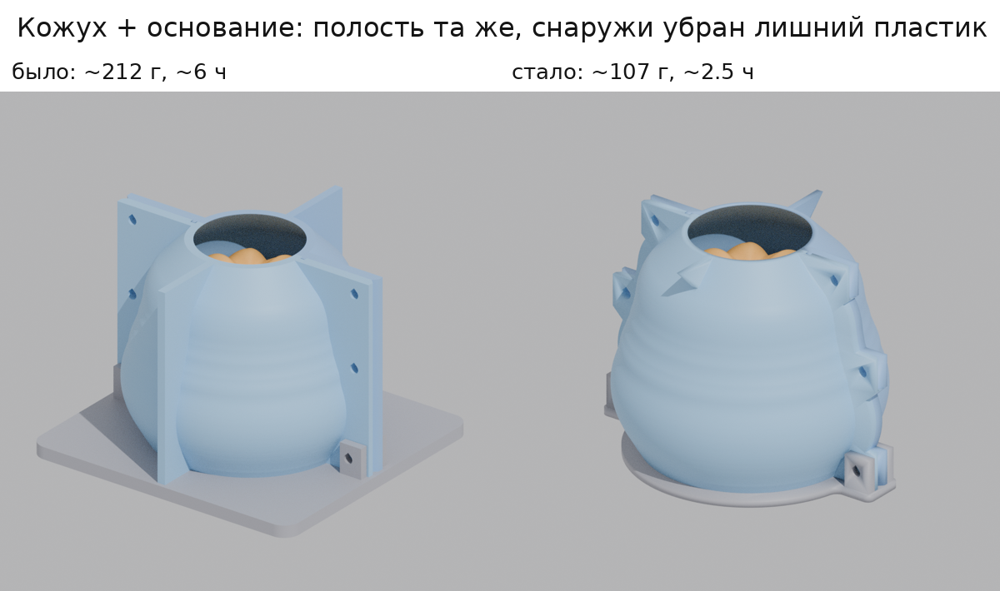
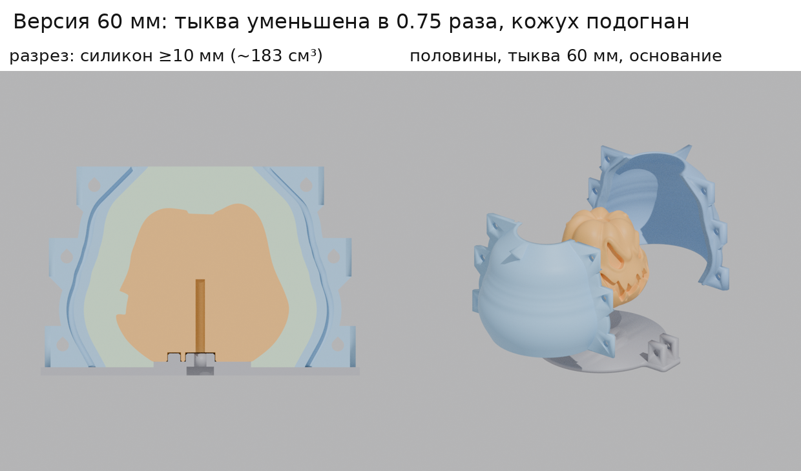
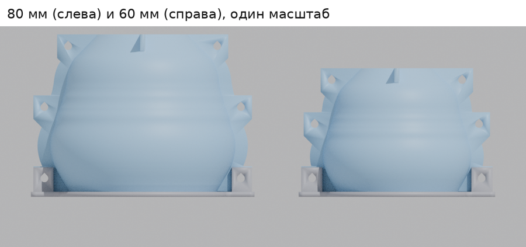

# Тыква для силиконовой формы: файлы для печати и кожух

Всё сделано из `forForm.zip` (модель `forForm.blend`). OBJ в корне репозитория не использовался.

## Файлы

| Файл | Что это |
|---|---|
| `print/pumpkin_for_mold.stl` | **Тыква-мастер для формы.** Высота 80 мм, в дне гнёзда под крепление к основанию кожуха |
| `print/pumpkin_no_holes.stl` | Та же тыква без отверстий в дне (если нужна просто фигурка) |
| `print/mold_shell_A.stl` | Половина кожуха A (с выступом-гребнем на стыке), облегчённая версия 2 |
| `print/mold_shell_B.stl` | Половина кожуха B (с пазом на стыке), облегчённая версия 2 |
| `print/mold_base.stl` | Основание кожуха (круглое, 3 мм): площадка под тыкву, центрирующий выступ и штифт, ушки для нижних болтов |
| `print_60mm/…` | **Версия 60 мм:** те же 5 файлов для тыквы, уменьшенной до 60 мм, и кожуха под неё (см. раздел 3) |
| `tools/build_mold.py` | Скрипт, которым всё это сгенерировано из `forForm.zip` (в нём можно поменять толщину силикона, высоту и т. п.) |

## 1. Тыква


Что изменено:

- **Размер:** высота 80 мм, в плане 84.7 × 84 мм.
- **Дно выровнено.** Плоское дно в исходной модели было наклонено на 0.44°, поэтому тыква касалась стола только краем. Я повернул модель целиком, как жёсткое тело: форма не меняется, а дно теперь лежит на столе всей площадью (~17 см²).
- **Сетка облегчена** с 1.94 млн до 0.7 млн треугольников. Максимальное отклонение от исходной поверхности 0.005 мм, это в 16 раз тоньше самого тонкого слоя печати. Файл весит 35 МБ вместо 97.
- **Только в `pumpkin_for_mold.stl`:** в дне есть гнездо Ø14.5 мм под центрирующий выступ, гнездо Ø6.5 мм под штифт (чтобы тыква не провернулась) и отверстие Ø3.4 мм под болт M4, который вкручивается снизу через основание. Дно в форму не копируется: на его месте будет отверстие готовой формы. Поэтому на отливках этих отверстий не будет.

Как проверял: итоговые STL сравнил с исходной моделью из `forForm.blend`. Выше дна отличие не больше 0.005 мм. Рендеры с 7 сторон практически совпадают с исходником попиксельно (отличается только дно версии для формы). Меш замкнутый, без дыр и вывернутых нормалей.
В исходной модели есть крошечное самопересечение поверхности (1–2 мм) в самом уголке рта. Оно было в оригинале, я его не трогал. Слайсер с таким справляется, на печать оно не влияет.

### Откуда «завитушки» сверху

Верх тыквы — это несколько очень пологих куполов (вершины долек) и плоский срез хвостика. Принтер печатает горизонтальными слоями, и на пологом месте каждый слой выходит наружу широкой ступенькой. Слайсер показывает эти ступеньки как кольца-«горизонтали», а маленькие островки между дольками заливает линиями «верхней поверхности». Это и есть завитушки. Из STL это не убрать: всё решает высота слоя.


Я нарезал модель в слайсере. При слое 0.08 мм и 4 стенках всю наружную поверхность печатает внешняя стенка, и островков верхней заливки не остаётся (0 г против отдельных пятен при 0.20 мм). Ступеньки остаются, но в 2.5 раза мельче.

### Настройки Bambu Studio для тыквы

1. Импортируйте `pumpkin_for_mold.stl`. **Не нажимайте «Auto orient»**: модель уже стоит правильно, дном на столе и лицом к переду стола.
2. Профиль процесса: **0.08mm Extra Fine** (или **0.08mm High Quality**: дольше, но поверхность ещё чище).
3. Вкладка *Strength*:
   - **Wall loops: 4.** Оболочка ~1.7 мм, тыква не промнётся, когда её будут вынимать из силикона.
   - **Top shell layers: 10.**
   - **Bottom shell layers: 5.**
   - **Sparse infill density: 10 %.**
   - **Sparse infill pattern: Lightning.** «Молния» строит заполнение только там, где оно нужно, чтобы держать верх. Внутри практически пусто: внутренности не важны, важна поверхность.
4. *Support*: **выключено.** Я проверил: при слое 0.08 мм ни один слой не нависает над предыдущим больше чем на ~1 мм, лицо печатается без поддержек. Если поддержки включить, слайсер полезет в отверстия в дне.
5. *Quality → Seam position*: **Back**. Шов уйдёт на затылок тыквы.

Расход по оценке слайсера: **~49 г PLA вместо ~77 г** при настройках по умолчанию (слой 0.20, заполнение 15 % «сетка»). Одно заполнение уменьшается с ~51 г до ~3 г. Печать из-за тонкого слоя будет дольше, точное время покажет Bambu Studio.

Совет для мастер-модели: силикон копирует всё, вплоть до следов слоёв. Если отливки нужны гладкими, нанесите 1–2 слоя грунта-наполнителя из баллончика и слегка отшлифуйте (P600–P800). Другой вариант — покрыть эпоксидным покрытием для 3D-печати. Перед заливкой краска и лак должны полностью высохнуть: свежее покрытие может помешать отверждению платинового силикона.

## 2. Кожух для заливки силикона

**Версия 2 (облегчённая).** Внутренняя полость кожуха, площадка под тыкву, выступ и штифт остались прежними, до сотой доли миллиметра. Тыква, которая уже печатается, подходит без изменений, толщина силикона та же. Снаружи убран лишний пластик:

| | было | стало |
|---|---|---|
| Стенка кожуха | 3 мм | 1.8 мм (давление силикона всего ~1 кПа) |
| Стык половин | сплошные фланцы во всю высоту + 2 больших ребра | узкий бортик вдоль стыка + 3 ушка под болты с каждой стороны |
| Опоры, чтобы кожух стоял вверх ногами | большие ребра | маленькие треугольные «ножки» у верхнего края |
| Основание | плита 140 × 132 × 6 мм | круг Ø101 × 3 мм + два ушка |
| Пластик (половина / основание / всё вместе) | ~74 / ~65 / ~212 г | ~42 / ~24 / **~107 г** |
| Время (половина / основание / всё вместе) | ~1 ч 53 мин / ~2 ч 10 мин / ~6 ч | ~49 мин / ~48 мин / **~2.5 ч** |

Цифры — оценка слайсера со скоростями как у Bambu. Для старой версии взяты прежние настройки (0.2 мм, 3 стенки, 15 %), для новой — настройки ниже. Точное время покажет Bambu Studio, но соотношение примерно такое.




### Как устроено и почему так

- **Тыква стоит дном вниз на основании и прикручена к нему снизу болтом M4.** Напечатанная тыква почти пустая (~50 г при объёме 278 см³), поэтому в жидком силиконе её выталкивало бы вверх с силой около 2.5 Н (~250 г), и она всплыла бы или перекосилась. Прикрученная болтом, она стоит намертво. Выступ и штифт ставят её точно по оси кожуха, поэтому силикон получается одинаковой толщины со всех сторон.
- **Силикон заливается сверху**, через отверстие Ø49 мм в верху кожуха (вы так и предлагали). Воздух свободно уходит вверх, уровень видно. Заливать до края, тогда над макушкой будет 11 мм.
- **Толщина силикона не меньше 10 мм везде:** минимум 10.0 мм, обычно 10.5–13 мм, в глазах, во рту и между дольками больше. Внутренняя стенка кожуха повторяет силуэт тыквы. Силикона нужно **~322 см³, это ~350–390 г** в зависимости от плотности (1.08–1.2 г/см³); берите с запасом 400–450 г. Для сравнения: прямоугольный короб, как на эскизе, съел бы ~800 г.
- **Две половины + основание**, как «1 часть» и «2 часть» на эскизе. Половины разделены вертикальной плоскостью. Внутренняя поверхность — тело вращения, поэтому каждая половина снимается вбок и ни за что не цепляется.
- **Дно тыквы становится отверстием готовой формы.** Под тыквой на основании есть площадка высотой 2 мм. Благодаря ей край отверстия в силиконе — полноценная стенка 2 мм, а не тонкая кромка «на ноль», которая быстро порвётся. У отливки снизу будет ровная «подошва» 2 мм: её можно сошлифовать или оставить.
- **Верхние ушки и треугольные ножки** доходят до верхнего края, поэтому кожух стоит и нормально, и вверх ногами (для отливки). Это ваши «грани, чтобы стояла».
- Вдоль стыка половин идёт **бортик с гребнем (A) и пазом (B)**: они точно совмещают половины и не дают силикону протекать по стыку.
- На внешних краях ушек есть **V-образные выемки**, в них удобно вставить отвёртку и разжать половины.

### Крепёж и материалы

- **7 болтов M4×30, 6 гаек M4, 12 шайб M4:**
  - 1 болт держит тыкву: снизу через основание в тыкву, сам нарезает резьбу в пластике.
  - 2 болта — нижние: проходят через ушки основания и нижние ушки обеих половин, держат кожух на основании.
  - 4 болта стягивают ушки посередине и вверху. Сюда подойдут и M4×16–M4×20.
  - Лайфхак: средние и верхние болты можно заменить канцелярскими зажимами (19–25 мм) на бортике стыка. Нижние 2 болта всё равно нужны: они держат кожух на основании.
- Клеевой пистолет (термоклей) для герметизации стыков.
- Разделитель (смазка для силиконовых форм), весы, стаканчики, палочка для перемешивания.
- Силикон: лучше **платиновый (аддитивный), твёрдость Shore 15–25A, удлинение при разрыве ≥300 %**. Отверстие формы (~48 мм по форме дна) уже, чем сама тыква (~85 мм), поэтому силикон должен хорошо тянуться.

### Печать кожуха и основания

Это технические детали: их поверхность не копируется в форму, поэтому печатать их нужно быстро, а не красиво.

- **Не печатайте кожух профилем тыквы (0.08 мм)!** На слое 0.08 одна половина печаталась бы в разы дольше самой фигурки. Делайте отдельный проект или стол со своим профилем.
- Профиль процесса **0.28mm Extra Draft**: слоёв почти в 1.5 раза меньше, чем при 0.2 мм.
- *Strength*: **Wall loops: 2**, **Top/Bottom shell layers: 3**, **Sparse infill density: 10 %**. Стенка 1.8 мм как раз заполняется четырьмя проходами (по два с каждой стороны), без заполнения и без «дырок».
- *Support*: **выключено.** Все наклоны не больше 45°, у ушек скошенный низ, отверстия каплевидные — поддержки не нужны (проверено нарезкой).
- Половины печатайте как в файле, стоя, нижним краем на столе. У них узкая опора (стенка 1.8 мм), поэтому оставьте **Brim: Auto** или поставьте внешнюю кайму 5 мм, чтобы высокая деталь не оторвалась от стола. Основание печатается плашмя.
- **Все три детали помещаются на один стол** X1/P1/A1 (256 мм): половины 129 × 56 мм, основание 132 × 101 мм. Одна печать вместо трёх экономит время на нагрев и калибровки. На A1 mini — две половины на одном столе, основание отдельно.
- Ещё несколько минут сэкономит отключение таймлапса и, если стол недавно калибровался, авто-выравнивания стола и калибровки потока в окне отправки на печать.
- Сопло 0.6 мм ставить ради этого не стоит: по тестам пользователей на форуме Bambu при стандартных лимитах потока выигрыш по времени небольшой или его нет совсем.

### Сборка и заливка

1. Если нужно, подготовьте поверхность тыквы (грунт, шлифовка — см. выше).
2. Поставьте тыкву на основание. Выступ и маленький штифт входят только в одном положении: лицом в сторону штифта. Вкрутите болт M4×30 снизу через основание в тыкву и затяните, чтобы дно плотно прижалось к площадке. Не перетягивайте, это пластик.
3. Нанесите разделитель на внутренние поверхности половин и на верх основания. На тыкву, если нужно, наносите очень тонко, иначе смажутся детали.
4. Поставьте половину A (с гребнем) и половину B (с пазом) вокруг тыквы так, чтобы нижние ушки половин вошли между ушками основания. Вставьте 2 нижних болта через ушки основания и половин, затем 4 болта в средние и верхние ушки (или поставьте зажимы на бортик). Затягивайте равномерно.
5. Снаружи пройдитесь термоклеем по стыку кожуха с основанием по всему периметру и по обоим вертикальным стыкам. Пластилин тоже подойдёт, но для платинового силикона — **только без серы**: сера не даёт ему застыть.
6. Замешайте силикон по инструкции производителя, компоненты точно взвесьте. Если есть вакуумная камера, дегазируйте.
7. Совет: перед сборкой (или до основной заливки) кисточкой промажьте глаза и рот тонким слоем того же силикона. Тогда в этих углублениях не останется пузырей.
8. Лейте с высоты 20–30 см тонкой струйкой в одну точку, на макушку тыквы. Силикон стекает вниз, уровень поднимается снизу, а тонкая струя растягивает и лопает пузыри. Заливайте до края верхнего отверстия.
9. Оставьте на время отверждения по инструкции (лучше с запасом) и не двигайте.

### Как вынуть

1. Выкрутите болт тыквы и 2 нижних болта, снимите основание.
2. Выкрутите 4 болта (или снимите зажимы) и разожмите половины через V-выемки. У вас в руках силиконовый блок с тыквой внутри.
3. Растяните отверстие снизу и выньте тыкву. Если она не выходит, надрежьте силикон зигзагом на затылке от отверстия примерно на 1/3 высоты. При отливке кожух будет держать разрез закрытым.


### Отливка

1. Вложите силиконовую форму обратно в половины и стяните их болтами или зажимами. Основание не нужно.
2. Переверните. Кожух встанет на верхний край, верхние ушки и ножки, и отверстие формы (дно тыквы) окажется сверху.
3. Залейте материал отливки (смолу, гипс, воск и т. п.) до края. Когда застынет, снимите половины и выньте отливку из силикона.

## 3. Версия 60 мм





Всё в папке `print_60mm/`, имена файлов те же, что у версии 80 мм. Файлы из разных папок не смешивайте: кожух и основание 60 мм подходят только к тыкве 60 мм.

- **Тыква** — это ровно та же модель, уменьшенная в 0.75 раза: 60 × 63.5 × 63 мм. Я проверил: `print_60mm/pumpkin_no_holes.stl` совпадает с версией 80 мм × 0.75 с точностью 0.000004 мм. Больше ничего в форме тыквы не менялось.
- **Силикон остался примерно сантиметровым:** минимум 10.0 мм, обычно 10.4–12.4 мм, над макушкой 11 мм. Кожух я не уменьшал вместе с тыквой, а заново подогнал под неё. Силикона нужно **~183 см³ (~200–220 г)**, с запасом берите 250 г.
- **Кожух.** Края верхнего отверстия на высоте 73 мм, само отверстие Ø38 мм. Устроен так же, как облегчённый кожух 80 мм: стенка 1.8 мм, бортик с гребнем и пазом, по 3 ушка под болты с каждой стороны, ножки у края, круглое основание 3 мм.
- **Крепёж в дне тыквы мельче**, потому что дно уже: выступ Ø10.5 мм вместо 14, штифт Ø4.5 мм вместо 6. Болт тот же M4, отверстие под него такой же глубины. Подходят болты M4×25 или M4×30, как и раньше.
- **Печать** — с теми же настройками, что для 80 мм. Тыкву печатайте профилем 0.08 мм, кожух и основание — 0.28 мм. Оценка слайсера со скоростями как у Bambu:

| деталь | пластик | время |
|---|---|---|
| тыква 60 мм (0.08 мм, 4 стенки, Lightning 10 %) | ~28 г | ~2 ч 50 мин |
| половина кожуха (0.28 мм) | ~28–29 г | ~37 мин |
| основание (0.28 мм) | ~19 г | ~42 мин |
| кожух + основание вместе | ~75 г | ~2 ч |

  Все три детали кожуха (113 × 46, 113 × 44 и 116 × 86 мм) помещаются на один стол, даже на A1 mini.
- Сборка, заливка, извлечение и отливка — как в разделе 2. В шаге с болтом тыквы для этой версии берите M4×25 или M4×30.

## Что не проверено на практике

- Нарезку я проверял в PrusaSlicer: в этой среде нет Bambu Studio, а его движок — форк PrusaSlicer. Цифры в Bambu Studio будут немного другими.
- Посадки рассчитаны на обычную точность FDM: зазор выступа и гнезда 0.25 мм на сторону, гребня и паза 0.3 мм, отверстия под M4 — 4.5 мм. Если на вашем принтере выйдет туго, пройдитесь надфилем или сверлом.
- Стенка 1.8 мм по расчёту с большим запасом держит давление силикона (~1 кПа), но вживую такой тонкий кожух ещё не проверялся.

## Как пересобрать

```
pip install bpy numpy scipy trimesh manifold3d pymeshlab shapely mapbox_earcut
python3 form/tools/build_mold.py
```

Версию 60 мм собирает команда `python3 form/tools/build_mold.py --height 60`, результат появится в `print_60mm/`. Параметры (толщина силикона `T_SIL`, высота площадки `H_PLAT`, крепёж для каждого размера в `SIZES`) — в начале скрипта.
