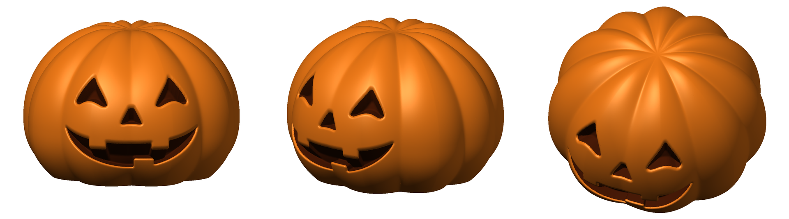

# Тыква Джек‑фонарь (Jack‑o'‑lantern) для 3D‑печати



Модель сделана с нуля по референсным фото: 10 долек (две передние, на которых
вырезано лицо, шире задних), мягкая ямка сверху вместо хвостика, плоское дно,
вырезанное лицо со скруглёнными краями: «улыбающиеся» глаза, нос‑треугольник и
улыбка с тремя зубами.

| Файл | Для чего |
|---|---|
| `jack_o_lantern.stl` | печать (Bambu Studio / любой слайсер), двоичный STL |
| `jack_o_lantern.obj` + `jack_o_lantern.mtl` | Blender (два материала: оранжевая кожура и тёмная «внутренность» прорезей) |
| `generate_jack_o_lantern.py` | генератор модели (параметрический, можно менять размеры/форму) |
| `preview.png` | превью |

## Характеристики

* Размер: **98,6 × 97,3 × 67,2 мм** (Ш × Г × В), единицы — миллиметры.
* Плоское основание Ø ≈ 74 мм (уже лежит на столе, Z = 0).
* Сетка замкнутая (watertight), одно тело, 300 000 треугольников, без вырожденных граней.
* Глубина прорезей лица — 6,5 мм.

## Печать в Bambu Studio

1. *Файл → Импорт* → `jack_o_lantern.stl`. Лицо смотрит на переднюю сторону стола (−Y).
2. **Поддержки не нужны.** Нижняя часть тыквы спроектирована с нависанием
   не круче ~50° (круче — только узкая полоска в первом миллиметре над столом
   у кромки основания и пара мм² на скруглениях рта).
   «Потолки» всех прорезей идут под 45°, поэтому глаза, нос и рот печатаются
   без поддержек и без провисаний.
3. Рекомендуемые настройки (PLA): слой 0,16–0,2 мм, 2–3 стенки, заполнение
   10–15 % (gyroid), без брима (основание большое).
4. Цвет: оранжевый пластик. Чтобы прорези были тёмными, как на фото:
   * с AMS — инструмент **Покраска цветом** (`N`) → кисть/заливка, закрасить
     внутренние стенки глаз, носа и рта тёмно‑коричневым или чёрным филаментом;
   * без AMS — подкрасить прорези акриловой краской после печати.
5. Масштабировать можно смело; при сопле 0,4 мм лучше не уменьшать меньше ~60 %,
   чтобы зазоры между зубами оставались чёткими.

## Открытие в Blender

*File → Import → Wavefront (.obj)* с настройками по умолчанию
(Forward: −Z, Up: Y). Тыква встанет вертикально (ось Z вверх), лицом к виду
спереди (Numpad 1). В файле есть сглаженные нормали и два материала.

Единицы в OBJ — миллиметры, то есть 1 единица Blender = 1 мм (модель ~98 единиц
в ширину). Если нужен реальный размер в метрах — при импорте поставьте
Scale = 0.001, либо в *Scene Properties → Units* задайте Unit Scale = 0.001 и
Length = Millimeters.

## Пересборка модели

```bash
pip install numpy scipy scikit-image trimesh fast-simplification pillow
python3 generate_jack_o_lantern.py
```

Скрипт описывает тыкву неявной функцией (поле расстояний): тело вращения с
дольками и ямкой сверху, плюс вырезанное лицо (контуры сняты с фронтального
фото и выровнены). Поле считается на воксельной сетке 0,25 мм, затем поверхность
строится алгоритмом marching cubes и упрощается до 300 тыс. треугольников.
Основные параметры (ширина, высота, число и глубина долек, размер основания,
глубина прорезей, положение и форма лица) — константы в начале файла.
